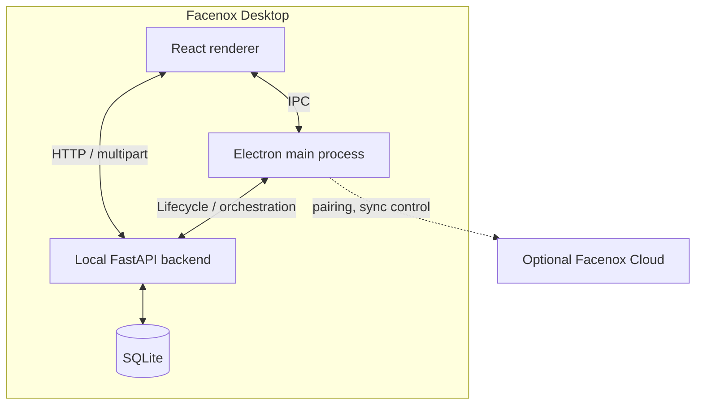

# Architecture

Facenox is a desktop-first system. Recognition, attendance, and biometric storage run on the local machine.

## Deployment Model

- Primary runtime: desktop app
- Primary database: local SQLite
- Network requirement for core attendance: none
- Face recognition: local; encrypted templates may sync between paired devices on supported Cloud plans
- Optional remote integration: separate Facenox Cloud deployment for reporting, device management, and encrypted template relay

## High-Level Components

## Desktop Responsibilities

### React renderer

- Camera and attendance UI
- Member and group management
- Settings, reports, and backup flows
- Facenox Cloud configuration UI

### Electron main process

- App lifecycle
- Backend startup and health monitoring
- Local settings persistence
- Update checks
- Facenox Cloud pairing and sync orchestration

### Local FastAPI backend

- Face detection and recognition endpoints
- Anti-spoofing and attendance APIs
- Export and import endpoints for backups and Cloud sync
- Local database access

### Local SQLite database

- Groups and members
- Attendance records and sessions
- Encrypted enrolled face data
- Audit and settings data

## Data Flow

### Desktop-only flow

1. The renderer captures camera frames and attendance input.
2. The renderer sends binary image data to the local FastAPI backend.
3. The backend runs detection, anti-spoofing, and recognition locally.
4. The backend writes results to the local SQLite database.

This path does not require internet access.

Packaged builds perform a non-blocking update check against GitHub after startup and no more than once every 24 hours. Online clock comparison is user-triggered from settings; routine clock protection and attendance processing do not contact a public time service.

### Facenox Cloud integration flow

1. An admin generates a pairing code in Facenox Cloud.
2. The desktop app stores the Cloud server address and redeems the pairing code.
3. The desktop receives an organization ID, site ID, device ID, and device token.
4. The desktop exports a local directory and attendance snapshot.
5. The Electron sync manager wraps that export in a sync envelope and sends it to `POST /api/sync/push`.
6. Push synchronizes dirty local groups, members, attendance, and biometric deletion markers with Cloud under revision control.
7. Next, the sync manager pulls Cloud updates from `GET /api/sync/pull` and imports them locally via `POST /attendance/import-metadata`. Even if push fails (e.g. quota limits), pulls continue so Cloud updates remain accessible.

The desktop remains the system of record for biometrics and local attendance capture.

Pairing also enables Cloud policies and authenticated remote administration. The current client can receive commands to wipe local Facenox data, reset the local admin PIN, or request an update check, and it returns the result to Cloud. These controls are separate from synchronization telemetry and require explicit disclosure and Cloud-side authorization.

Local directory management (creating, editing, and deleting groups/members) is fully supported while paired. Edits are revisioned: local changes are marked dirty and pushed to Cloud along with acknowledged revisions. Cloud updates advance revisions and are applied locally without overwriting in-flight local modifications.

On supported Cloud plans, encrypted face templates can sync between computers paired to the same location. Templates are encrypted before upload and decrypted by destination computers. Cloud stores encrypted templates and manages location keys. Server-side location transfers can decrypt and re-encrypt templates with the destination location's key.

## Desktop and Facenox Cloud Boundary

The Facenox Cloud boundary is intentionally narrow.

### Data that stays local

- Raw face images used for enrollment and recognition (not uploaded to Cloud)
- Local face matching decisions
- Local enrollment workflow and capture pipeline artifacts

### Data sent through authenticated Cloud connections

- **Encrypted face templates** (AES-256-GCM encrypted; key access is described above)
- Organization, site, and device identifiers
- Attendance records and sessions
- Device name, app version, sync timestamps, outcomes, and operational activity

### Data that is sent for reporting and directory sync

- Group and member metadata (revision-tracked, pushed when modified locally)
- Attendance records and sessions (needed for reporting)
- Face enrollment tombstones (deletion markers applied by paired computers when they sync)

## Sync Model

The sync design is event-driven and resilient.

- Push-and-pull sync: desktop pushes dirty directory changes and attendance snapshots, then pulls Cloud revisions and updates
- Decoupled download: pull operations proceed even if a push fails (such as on member quota limits)
- Real-time triggers: the desktop receives sync notifications; remote notifications trigger a pull-only cycle to avoid cross-device ping-pong feedback loops
- Revisioned directory sync: groups and members track monotonic revisions (`sync_revision`) and dirty markers (`sync_dirty`). Absence on a page never prunes records; deletions and transfers are conveyed via explicit tombstones
- Local-first control: member and group mutations are executed locally in SQLite first, and propagated during sync with conflict detection
- Auto-sync available in the desktop app (defaulting to 15-minute intervals, plus debounced triggers on local edits)
- Manual `Sync Now` available as an override
- Initial sync runs immediately after pairing
- Catch-up sync runs on startup when the device is overdue

Cloud connectivity is not required for local attendance recording.

## Not in This Repository

This repository does not implement:

- Remote-side face matching
- Payroll or HRIS integrations
- Mobile clients

Do not infer availability in Facenox Cloud from this list. Consult the Cloud documentation for its supported features.
